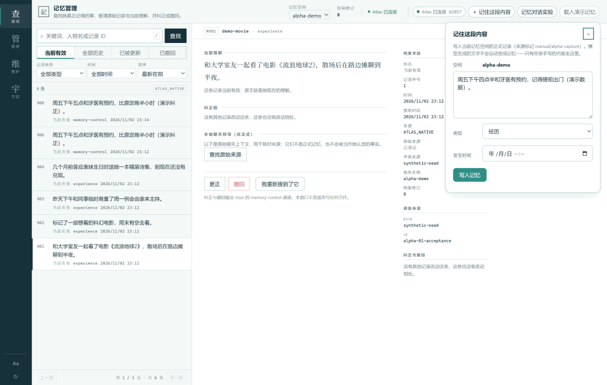
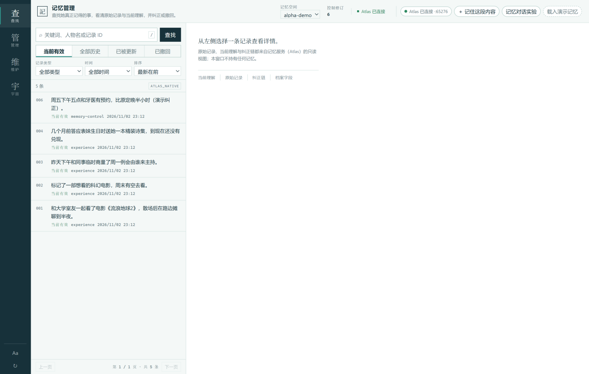
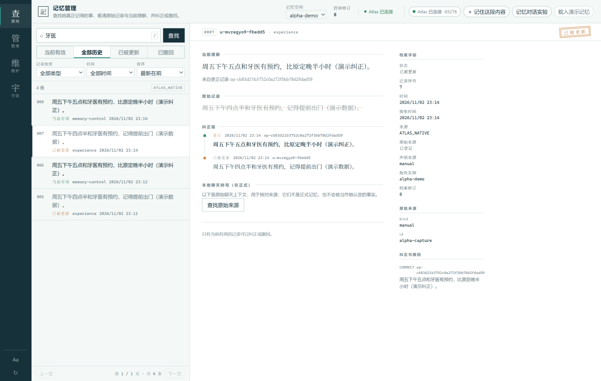
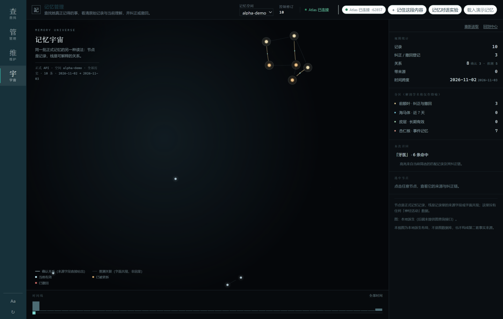

# Memory Atlas

A memory library that runs on your own machine. You put things in, you can find them again, you can fix them, you can take them back — and every record keeps its history.

  



The problem it solves is specific: the more you work with AI tools, the more your plans, promises and preferences scatter across conversations you'll never find again. Memory Atlas puts them in one local program. You write them down yourself, you correct them yourself, and any AI you connect can only query the part you explicitly granted — seeing the currently valid version by default.

This is an open-source Alpha. The core works; the limits are written down in [What's verified and what isn't](#whats-verified-and-what-isnt) rather than left for you to discover.

中文说明：[README.zh-CN.md](README.zh-CN.md)

## Download

| File | For |
|---|---|
| [MemoryAtlas-v0.1.0-alpha.1-win-x64.zip](https://github.com/sslbs09/memory-atlas/releases/download/v0.1.0-alpha.1/MemoryAtlas-v0.1.0-alpha.1-win-x64.zip) | Windows 10/11 x64, portable |

- No Node, no Python, no terminal — the runtime ships inside the package.
- Your data lives in `%APPDATA%\Memory Atlas Alpha\`; deleting the extracted folder deletes nothing of value.
- The build is not code-signed, so Windows will warn on first launch: click "More info" → "Run anyway".
- Release assets include a `SHA256SUMS` file if you want to verify the download.

Older releases: [Releases](https://github.com/sslbs09/memory-atlas/releases).

## Three ways to use it

**As a desktop memory book.** Open the program and keep records by hand — search, correct, retract.



**As memory for your AI tools.** The app ships with an MCP server (read-only by default). Any MCP-capable tool — coding assistants, bot frameworks, your own agents — gets query access to one memory space you choose with a single launch command. Configs below.

**From your own code.** The Atlas service serves an HTTP API on loopback: every write returns a receipt, replays are recognized, retractions take effect immediately. A zero-dependency Node client ships in the repo.

## Two minutes to first memory

1. Download the ZIP and extract it anywhere (Chinese characters and spaces in the path are fine).
2. Double-click `MemoryAtlas.exe`. On first launch it prepares its search index; wait for "Atlas connected" in the top bar.
3. (Optional look-around) Click **载入演示记忆** (load demo memories) in the top-right. It fills a demo space called `alpha-demo` with synthetic records — separate from your data — and switches the space dropdown to it. **When you're done, switch the dropdown (top-left) back to `alpha`**: your own memories go into alpha, and that's the space your agent will bind to in the next section.
4. **Write your first record**: make sure the 记忆空间 (space) dropdown shows `alpha`, click **＋ 记住这段内容** (remember this), type one sentence — for example "dentist appointment Friday 4:30 pm" — click **写入记忆** (write), then **刷新列表查看** (refresh the list) in the panel. The record is in the list.
5. **Search**: type a keyword (say, 牙医) in the left search box and click **查找**.
6. **Correct it**: click the record, scroll the detail pane, click **更正** (correct), write the right version, click **保存纠正** (save correction). The old wording isn't deleted — switch the list to 全部历史 (all history) and you'll see it marked 已被更新 (superseded).
7. **Retract one**: click 撤回 (retract) in the detail pane. It disappears from "currently valid" and stays under the 已撤回 (retracted) tab.

That's the whole loop. One thing to know up front: search doesn't do synonyms. Searching 约定 will not match 答应 — when there's no hit, it says so instead of guessing.

## Connecting your AI agent

One prerequisite: Memory Atlas must be running (it owns the data and the index; the MCP server is only a bridge).

Two files from the package matter to your config:

- MCP server: `<install>\resources\app\mcp\atlas-mcp.mjs`
- Bundled Node runtime: `<install>\resources\app\runtime\node.exe`

**About spaces**: a fresh install has exactly one space, `alpha`, created on first launch — the examples below all use it. In the current version the "create space" form only appears in the UI when no space exists at all; that's a known limitation ([issue #1](https://github.com/sslbs09/memory-atlas/issues/1), planned for a future release). For a quick look at synthetic data, 载入演示记忆 gives you the `alpha-demo` space — it is not a way to create spaces. Also note that `--data-dir` pointing at a new directory starts a **completely separate data environment** — its own `alpha`, its own index, sharing nothing with your existing data — it does not add a space to your current Atlas.

Generic `mcpServers` JSON (Claude Desktop and similar clients. Config example, unverified — the hosts we actually tested are DSH and MaiBot):

```json
{
  "mcpServers": {
    "memory-atlas": {
      "command": "C:\\path\\to\\resources\\app\\runtime\\node.exe",
      "args": ["C:\\path\\to\\resources\\app\\mcp\\atlas-mcp.mjs"],
      "env": {
        "MEMORY_ATLAS_SPACE": "alpha",
        "MEMORY_ATLAS_DATA_DIR": "C:\\Users\\you\\AppData\\Roaming\\Memory Atlas Alpha\\atlas-data"
      }
    }
  }
}
```

| Environment variable | Required | Meaning |
|---|---|---|
| `MEMORY_ATLAS_SPACE` | yes | The one memory space this client may access. The model cannot switch spaces |
| `MEMORY_ATLAS_DATA_DIR` | pick one | Atlas data directory (default `%APPDATA%\Memory Atlas Alpha\atlas-data`); the server discovers the running service from here |
| `MEMORY_ATLAS_URL` + `MEMORY_ATLAS_READ_TOKEN` | pick one | Direct-connect mode instead of discovery |
| `MEMORY_ATLAS_ALLOW_WRITES` | no | Set to `1` to expose write tools — see below |

When it works, the agent's tool list contains `atlas_search` (currently-valid memories by default; the `status` parameter can query history explicitly), `atlas_get` (details and the correction chain by record ID — superseded and retracted records are readable too), and `atlas_health` (connectivity). A quick check: ask it to "look up memories about the dentist" and it should return record contents, not an error.

**Verifying your first connection**, in two layers:

Layer 1 (verified): call the tools directly, no model involved. After starting an MCP client bound to `alpha`, call `atlas_health` first — it should return `available: true`, `spaceExists: true`; then call `atlas_search` with the keyword you just wrote on the desktop (say, 牙医) — it should return that record, with the same recordId the desktop detail pane shows. We ran this end to end against the release package: fresh boot → write into alpha → two separate MCP clients both returned the same record (same recordId), while a client bound to a different space could not see it.

Layer 2 (not verified): the model deciding on its own when to call these tools. Tool registration and the protocol are in place, but model-initiated use is the next layer of the experience and has no test results yet — tools being registered does not mean your model will use them, or use them well.

**DeepSeek Harness (DSH)** — no changes to your existing profile; use a `--patch` overlay (verified: registration and discovery):

<details>
<summary>DSH config example</summary>

Save as `dsh-atlas-patch.yml`, then run
`dsh --profile headless --patch <path>\dsh-atlas-patch.yml "your task"`:

```yaml
- insert:
    - id: mcp-atlas
      name: "@deepseek-ai/dsh-mcp-client"
      config:
        serverName: atlas
        transport: stdio
        command: "C:\\path\\to\\resources\\app\\runtime\\node.exe"
        args:
          - "C:\\path\\to\\resources\\app\\mcp\\atlas-mcp.mjs"
        env:
          MEMORY_ATLAS_SPACE: alpha
          MEMORY_ATLAS_DATA_DIR: "C:\\Users\\you\\AppData\\Roaming\\Memory Atlas Alpha\\atlas-data"
        failOnStartupError: false
```

Tools appear as `mcp__atlas__atlas_search` and friends. Verified on DSH 0.2.1-rc.3 (registration and discovery).
</details>

**MaiBot** — append to the `[mcp]` section of `bot_config.toml`; no core changes, its own memory system stays untouched (verified: connect, discovery, query through its own client):

<details>
<summary>MaiBot config example</summary>

```toml
[[mcp.servers]]
name = "memory-atlas"
transport = "stdio"
command = "C:\\path\\to\\resources\\app\\runtime\\node.exe"
args = [
  "C:\\path\\to\\resources\\app\\mcp\\atlas-mcp.mjs"
]
env = { MEMORY_ATLAS_SPACE = "alpha", MEMORY_ATLAS_DATA_DIR = "C:\\Users\\you\\AppData\\Roaming\\Memory Atlas Alpha\\atlas-data" }
```

MaiBot passes these tools to the model under their plain names. Verified on 1.3.6 with its built-in MCP client (connect, discovery, query, detail).
</details>

**Codex (OpenAI)** — Codex reads TOML from `~/.codex/config.toml`, which is a different shape from the JSON above (config example, unverified):

<details>
<summary>Codex config example (TOML)</summary>

```toml
[mcp_servers.memory-atlas]
command = "C:\\path\\to\\resources\\app\\runtime\\node.exe"
args = ["C:\\path\\to\\resources\\app\\mcp\\atlas-mcp.mjs"]
startup_timeout_sec = 20

[mcp_servers.memory-atlas.env]
MEMORY_ATLAS_SPACE = "alpha"
MEMORY_ATLAS_DATA_DIR = "C:\\Users\\you\\AppData\\Roaming\\Memory Atlas Alpha\\atlas-data"
```

Field names follow Codex's official docs (`mcp_servers.<id>` tables; stdio uses `command`/`args`/`env`). We have not run Codex against Memory Atlas ourselves — the syntax is per their documentation, the integration is not.
</details>

**About writing**: by default the agent only gets the three query tools. To enable `atlas_remember` / `atlas_correct` / `atlas_retract`, add `MEMORY_ATLAS_ALLOW_WRITES: "1"` to the env — and even then, treat them as tools the model may use only when the user clearly says so. Memory Atlas has no automatic memory capture: it does not read your chats and save things on its own.

## When a memory is wrong

Correcting a record retires the old wording without deleting it:



The struck-through line is the original; the archive fields on the right record who changed what, when. The part that matters more: **the correction applies to every client**. Real output from an MCP client, before and after (same memory, same query):

```text
=== atlas_search { query: '小林' } — before ===
{ "outcome": "MATCHED",
  "records": [ { "recordId": "mcp-mvzge5lv-hn1gw9", "status": "active",
                 "matchReason": ["term:小林(cjk-2)", "recency:1.000"] } ] }

=== atlas_correct { recordId: 'mcp-…', content: '上个月和小陈一起看过电影。' } ===
accepted (Atlas receipt outcome=RECORDED)

=== atlas_search { query: '小林' } — after ===
{ "outcome": "NO_MATCH", "records": [] }

=== atlas_search { query: '小陈 电影' } — after ===
{ "outcome": "MATCHED",
  "records": [ { "recordId": "ctl-d96f5b0c-…", "status": "active" } ] }
```

Searching the old name no longer returns it as a current fact; the corrected version is what every client sees by default. The old record isn't gone — the desktop keeps it under 已被更新 (superseded) / 已撤回 (retracted), and MCP clients can read it too: `atlas_get` fetches old records by ID and `atlas_search`'s `status` parameter queries history explicitly. The only thing that changed is the standing of the record: **it is no longer a currently-valid fact**. The desktop app and MCP clients share one memory and one correction chain — that is the core design of this project.

The same records also have a second reading — Memory Universe, where nodes are records and lines are their (explainable, source-derived) relations:



## What's verified and what isn't

Verified (evidence in [docs/VERIFICATION-v0.1.0-alpha.1.md](docs/VERIFICATION-v0.1.0-alpha.1.md)):

- Portable package, fresh extraction: 36 automated checks (write, query, correct, retract, single-instance, clean shutdown with no orphan processes, restart persistence)
- DSH 0.2.1-rc.3: MCP tool registration and discovery
- MaiBot 1.3.6: connect, discovery, query and detail through its own MCP client
- Three clients sharing one space: corrections and retractions propagate to all of them; spaces don't leak into each other

Not verified — treat accordingly:

- Real models calling the tools end-to-end: the DSH account had no model quota at test time, so the full model loop never ran. The tool protocol works; that is not the same claim
- 20 GB scale: never tested; the capacity figure is a configuration value
- Semantic search: none. Word-based matching, no synonyms, no vectors, no "understanding"
- Automatic memory capture: none. Memories come from you (or calls you explicitly authorized), never from reading other software's chats

## FAQ

<details>
<summary>Windows blocks the first launch (SmartScreen)</summary>

The build isn't signed. Click "More info" → "Run anyway", or verify the SHA-256 from the Release page first.
</details>

<details>
<summary>The agent says "Atlas service not running / endpoint.json not found"</summary>

The desktop app isn't running, or `MEMORY_ATLAS_DATA_DIR` points elsewhere. Start the app and check that `%APPDATA%\Memory Atlas Alpha\atlas-data` exists. If Atlas restarts, MCP clients follow the new port automatically.
</details>

<details>
<summary>A memory doesn't show up in search</summary>

Check the space (the client's bound space may differ from what you're viewing on the desktop), then search with words that actually appear in the record. No synonyms, no fuzz.
</details>

<details>
<summary>Where is my data; how do I back it up</summary>

Everything is in `%APPDATA%\Memory Atlas Alpha\` (config and memory data). Copy that folder — that's the backup.
</details>

<details>
<summary>Can several agents share it</summary>

Yes — they all connect to the same running Atlas, and `MEMORY_ATLAS_SPACE` decides what each one sees:

- **To share one memory**: bind them to the same space. With the default read-only access this is the standard setup — every client sees the same records (same recordIds; verified).
- **To keep agents separate**: give each its own space; they can't see each other (verified).
- Several clients **writing** to one space also works. Deduplication is by record identity, not by content: if two clients each write down the same fact as their own records, you get two records. If you want one authoritative record per fact, have one side do the writing and the others stay read-only.
</details>

## For developers

- [docs/ARCHITECTURE.md](docs/ARCHITECTURE.md) — data model, service architecture, the index trust model, building from source
- [release/docs/MCP-GUIDE.md](release/docs/MCP-GUIDE.md) — MCP integration details and ground rules
- Memory API: loopback HTTP; [src/client.js](src/client.js) is a zero-dependency Node client and doubles as the API reference
- [docs/VERIFICATION-v0.1.0-alpha.1.md](docs/VERIFICATION-v0.1.0-alpha.1.md) — every verification item and its evidence
- [CHANGELOG.md](CHANGELOG.md)

## License and credits

Original content is released under the [MIT License](LICENSE). Third-party components keep their own licenses: Electron, Node.js, the MCP TypeScript SDK (Apache-2.0), 3d-force-graph and its embedded dependencies, FFmpeg inside Electron — full list in [THIRD_PARTY_NOTICES.md](THIRD_PARTY_NOTICES.md), with FFmpeg's corresponding-source statement in [FFMPEG-LGPL-SOURCE.md](FFMPEG-LGPL-SOURCE.md).

The retrieval index shares lineage with an earlier internal engineering line; provenance is recorded in [desktop/PROVENANCE.md](desktop/PROVENANCE.md).
