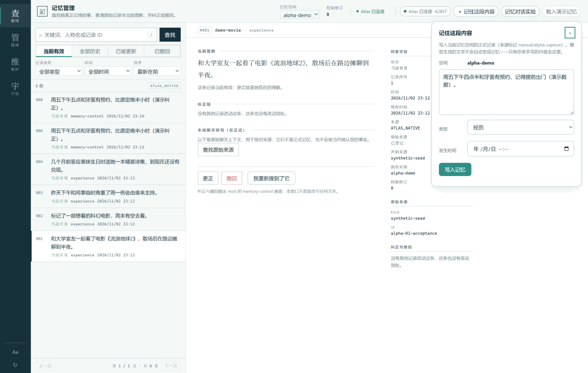
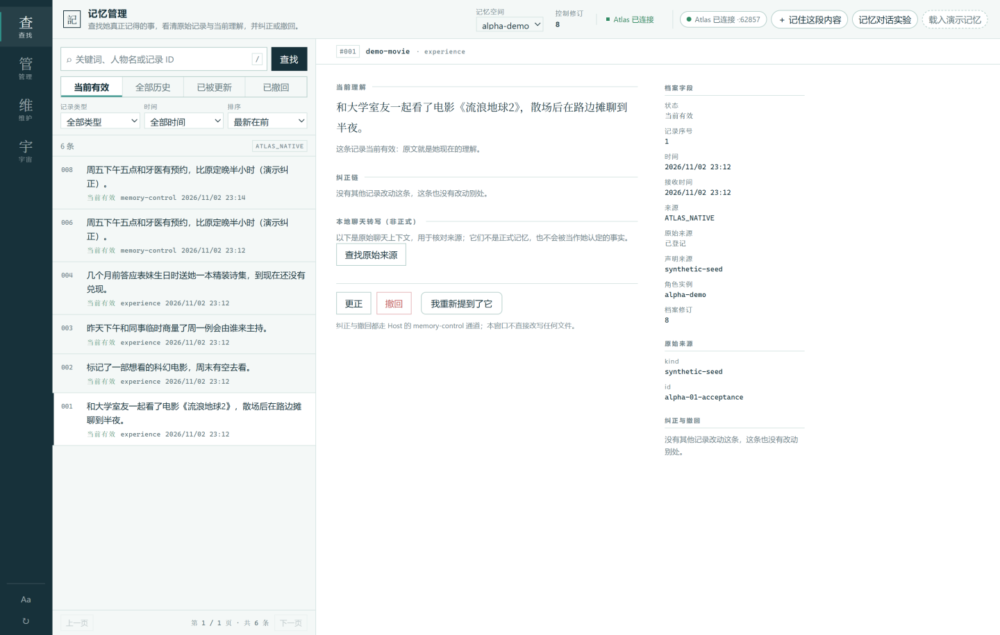
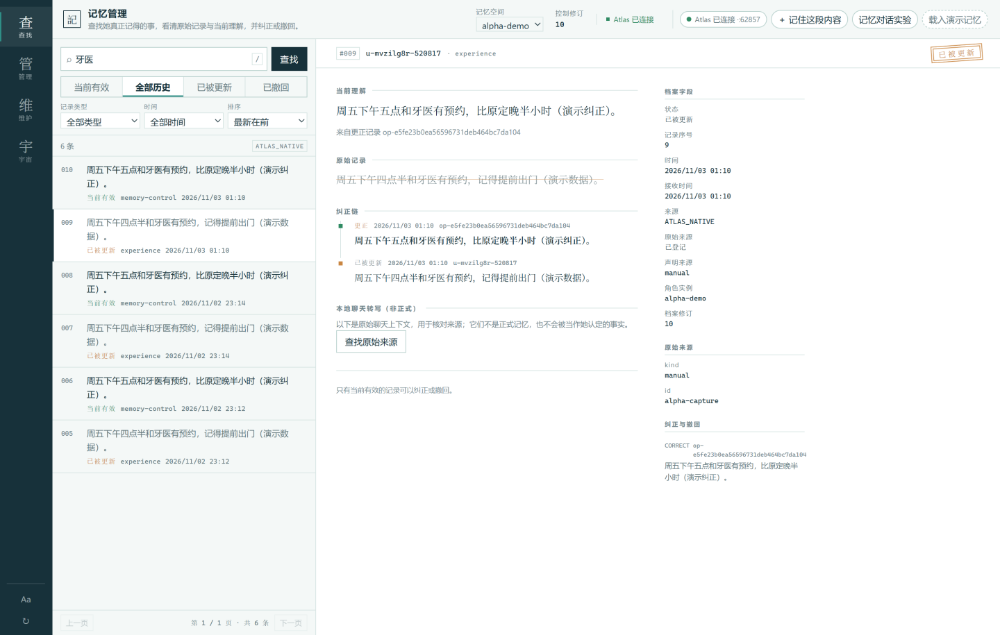
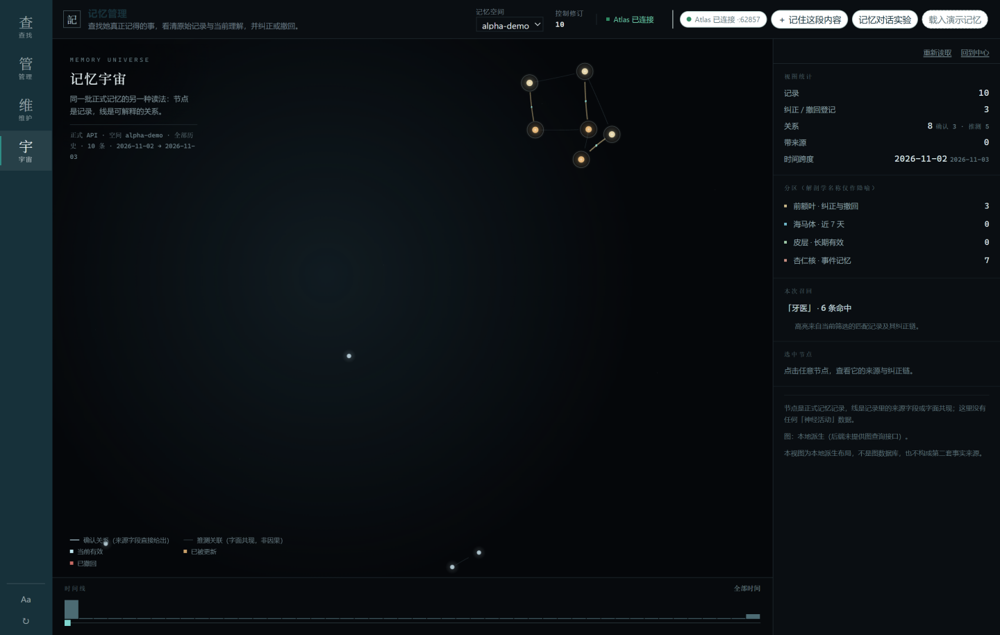

# Memory Atlas

一个装在你电脑上的记忆库。事情记下来，之后能查到、能改、能撤回——每一条都留着来龙去脉。

  



它解决一个具体的问题：和 AI 工具打交道越多，"说过的话、定过的事"散得越广，回头想不起来在哪。Memory Atlas 把这些事放进一个本地程序：你亲手记、亲手改；连接的 AI 只能查询你明确授权的部分，查到的默认是当前有效的版本。

这是 Alpha 阶段的开源项目。核心功能完整可用，没验证过的部分在[能力边界](#能力边界)里写明白。

English version: [README.md](README.md)

## 下载

| 文件 | 适合 |
|---|---|
| [MemoryAtlas-v0.1.0-alpha.1-win-x64.zip](https://github.com/sslbs09/memory-atlas/releases/download/v0.1.0-alpha.1/MemoryAtlas-v0.1.0-alpha.1-win-x64.zip) | Windows 10/11 x64，解压即用 |

- 不需要装 Node、Python，不需要命令行——运行时都在包里。
- 数据存在 `%APPDATA%\Memory Atlas Alpha\`，删掉解压目录不丢数据。
- 安装包没有代码签名，第一次运行 Windows 会拦一下：点「更多信息 → 仍要运行」。
- 在意完整性的话，Release 页的 `SHA256SUMS` 里有哈希可以核对。

历史版本见 [Releases](https://github.com/sslbs09/memory-atlas/releases)。

## 三种用法

**当个桌面记忆本。** 打开程序，手动记录、查询、更正、撤回。



**给 AI 一个可查的记忆。** 程序自带一个 MCP Server（只读默认）。支持 MCP 的 AI 工具——编程助手、聊天机器人框架、你自己的 Agent——配一条启动命令就能查询你指定的记忆空间。下面有现成配置。

**接进自己的程序。** Atlas 服务在本机环回地址上开 HTTP API：每次写入有回执，重复提交能识别，撤回立即生效。仓库里带一个零依赖的 Node 客户端。

## 两分钟上手

1. 下载 ZIP，解压到任意目录（中文路径、带空格的路径都没问题）。
2. 双击 `MemoryAtlas.exe`。首次启动它会自己准备检索索引，等顶栏出现「Atlas 已连接」。
3. 先点右上角 **载入演示记忆**：它写入一个叫 `alpha-demo` 的演示空间（合成数据，和你的数据隔离），左上角「记忆空间」下拉会自动切过去。列表里会出现几条示例。
4. **写第一条**：右上角 **＋ 记住这段内容**，写一句话——比如「周五下午四点半和牙医有预约」——点 **写入记忆**，然后点面板里的 **刷新列表查看**。列表里就能看到它。
5. **查询**：左侧输入框输入关键词（比如「牙医」），点 **查找**。
6. **改**：点开那条记录，右侧详情往下拉，点 **更正**，写上正确内容，点 **保存纠正**。旧版本不会消失：列表切到「全部历史」还能看到，标记着「已被更新」。
7. 想删掉一条：详情里点 **撤回**。「当前有效」里它就不出现了，「已撤回」标签下还留着原始记录。

就这些。最后说明一点：搜索不做同义改写，搜「约定」不会命中「答应」——搜不到时它如实告诉你没有，不猜。

## 连接你的 AI Agent

前提只有一个：Memory Atlas 正在运行（它拥有数据和索引，MCP server 只是个桥）。

随包有两个文件要指给 MCP 客户端：

- MCP server：`<解压目录>\resources\app\mcp\atlas-mcp.mjs`
- Node 运行时：`<解压目录>\resources\app\runtime\node.exe`

**关于空间**：全新安装只有一个 `alpha` 空间（首次启动自动创建），下面的示例都用它。
当前版本的界面只有在还没有任何空间时才会出现「创建空间」入口——这是已知的产品限制，
正常情况下想多一个空间，可以点「载入演示记忆」得到 `alpha-demo`，或者换一个数据目录
（`--data-dir`）重新开始。多 Agent 各用各的空间、或共用一个空间，都靠这个绑定决定（见下）。

通用 MCP 配置（Claude 桌面版等用 `mcpServers` JSON 格式的客户端。配置示例，未验证——
我们实测过的宿主只有 DSH 和 MaiBot）：

```json
{
  "mcpServers": {
    "memory-atlas": {
      "command": "C:\\你的解压目录\\resources\\app\\runtime\\node.exe",
      "args": ["C:\\你的解压目录\\resources\\app\\mcp\\atlas-mcp.mjs"],
      "env": {
        "MEMORY_ATLAS_SPACE": "alpha",
        "MEMORY_ATLAS_DATA_DIR": "C:\\Users\\你\\AppData\\Roaming\\Memory Atlas Alpha\\atlas-data"
      }
    }
  }
}
```

| 环境变量 | 必填 | 说明 |
|---|---|---|
| `MEMORY_ATLAS_SPACE` | 是 | 这个客户端被授权访问的记忆空间。一个实例只绑一个空间，模型换不了 |
| `MEMORY_ATLAS_DATA_DIR` | 二选一 | Atlas 数据目录（默认 `%APPDATA%\Memory Atlas Alpha\atlas-data`），从这里发现正在运行的服务 |
| `MEMORY_ATLAS_URL` + `MEMORY_ATLAS_READ_TOKEN` | 二选一 | 直连模式，不走自动发现 |
| `MEMORY_ATLAS_ALLOW_WRITES` | 否 | 设为 `1` 才会出现写入工具，见下文 |

配好后，Agent 的工具列表里会出现 `atlas_search`（默认查当前有效的记忆；`status` 参数可以显式查历史）、`atlas_get`（按 ID 看详情和更正链，也能看已被更新/已撤回的旧记录）、`atlas_health`（检查连接）。连得上的标志：问它一句「查一下关于牙医的记忆」，它返回记录内容而不是报错。

**首次连接怎么验证**（对应一条真实跑通的路径）：先在桌面程序里写一条记忆（比如
「周五下午四点半和牙医有预约」，记得此时空间选的是 alpha）；再启动绑定了 alpha 的
MCP 客户端，让它查「牙医」——它应该返回刚才那条记录，recordId 与桌面端详情里显示的
一致。这条链路我们在发行包上实测通过：全新启动 → 写入 alpha → 两个 MCP 客户端都查到
同一条记录（同 recordId），绑定到独立空间的客户端则查不到。

**DSH（DeepSeek Harness）** —— 不改现有 Profile，用 `--patch` 叠加（已实测：工具注册与发现）：

<details>
<summary>DSH 配置示例</summary>

把下面内容存成 `dsh-atlas-patch.yml`，然后
`dsh --profile headless --patch 路径\dsh-atlas-patch.yml "你的任务"`：

```yaml
- insert:
    - id: mcp-atlas
      name: "@deepseek-ai/dsh-mcp-client"
      config:
        serverName: atlas
        transport: stdio
        command: "C:\\你的解压目录\\resources\\app\\runtime\\node.exe"
        args:
          - "C:\\你的解压目录\\resources\\app\\mcp\\atlas-mcp.mjs"
        env:
          MEMORY_ATLAS_SPACE: alpha
          MEMORY_ATLAS_DATA_DIR: "C:\\Users\\你\\AppData\\Roaming\\Memory Atlas Alpha\\atlas-data"
        failOnStartupError: false
```

工具会以 `mcp__atlas__atlas_search` 这样的名字出现。已在 DSH 0.2.1-rc.3 上验证注册与发现。
</details>

**MaiBot** —— 在 `bot_config.toml` 的 `[mcp]` 段追加，不动它的核心和原有记忆系统（已实测：自带客户端连接、发现、查询）：

<details>
<summary>MaiBot 配置示例</summary>

```toml
[[mcp.servers]]
name = "memory-atlas"
transport = "stdio"
command = "C:\\你的解压目录\\resources\\app\\runtime\\node.exe"
args = [
  "C:\\你的解压目录\\resources\\app\\mcp\\atlas-mcp.mjs"
]
env = { MEMORY_ATLAS_SPACE = "alpha", MEMORY_ATLAS_DATA_DIR = "C:\\Users\\你\\AppData\\Roaming\\Memory Atlas Alpha\\atlas-data" }
```

MaiBot 按原名使用这些工具。已在 1.3.6 版用其自带 MCP 客户端验证连接与查询。
</details>

**Codex（OpenAI）** —— Codex 用 `~/.codex/config.toml` 的 TOML 格式，和上面的 JSON
不是一种写法（配置示例，未验证）：

<details>
<summary>Codex 配置示例（TOML）</summary>

```toml
[mcp_servers.memory-atlas]
command = "C:\\你的解压目录\\resources\\app\\runtime\\node.exe"
args = ["C:\\你的解压目录\\resources\\app\\mcp\\atlas-mcp.mjs"]
startup_timeout_sec = 20

[mcp_servers.memory-atlas.env]
MEMORY_ATLAS_SPACE = "alpha"
MEMORY_ATLAS_DATA_DIR = "C:\\Users\\你\\AppData\\Roaming\\Memory Atlas Alpha\\atlas-data"
```

字段以 Codex 官方文档为准（`mcp_servers.<id>` 段，stdio 用 `command`/`args`/`env`）。
我们没有实际联调过 Codex，配置按其文档语法给出，未经运行验证。
</details>

**关于写入**：默认只有上面三个查询工具。要开写入（`atlas_remember` / `atlas_correct` / `atlas_retract`），在 env 里加 `MEMORY_ATLAS_ALLOW_WRITES: "1"`。开了之后也请只在用户明确说「记住这个」「改一下」时调用——Memory Atlas 目前没有自动记忆：它不会偷读你的聊天记录自己存。

## 记错了怎么办

程序里改一条记录，原始版本不删、直接作废：



划线的是原始记录，右侧档案字段记着谁在什么时候改的。更重要的规则是：**这个更正对所有客户端生效**。下面是 MCP 客户端在更正前后的真实输出（同一份记忆，同一套查询）：

```text
=== atlas_search { query: '小林' } — 更正前 ===
{ "outcome": "MATCHED",
  "records": [ { "recordId": "mcp-mvzge5lv-hn1gw9", "status": "active",
                 "matchReason": ["term:小林(cjk-2)", "recency:1.000"] } ] }

=== atlas_correct { recordId: 'mcp-…', content: '上个月和小陈一起看过电影。' } ===
已提交（Atlas 回执 outcome=RECORDED）

=== atlas_search { query: '小林' } — 更正后 ===
{ "outcome": "NO_MATCH", "records": [] }

=== atlas_search { query: '小陈 电影' } — 更正后 ===
{ "outcome": "MATCHED",
  "records": [ { "recordId": "ctl-d96f5b0c-…", "status": "active" } ] }
```

搜「小林」不再是当前事实，搜「小陈」拿到新版本——旧的不会从历史里消失，「已撤回」「已被更新」标签下永远可查；MCP 端也一样，`atlas_get` 能读旧记录，`atlas_search` 的 `status` 参数可以显式查历史。变化只有一条：**它们不再作为"当前有效的事实"出现**。桌面程序和 MCP 客户端看到的是同一份记忆、同一条更正链，这是这个项目最重要的一条设计。

同一批记忆还有第二种读法——记忆宇宙：节点是记录，线是可解释的来源关系。



## 能力边界

**验证过的**（证据在 [docs/VERIFICATION-v0.1.0-alpha.1.md](docs/VERIFICATION-v0.1.0-alpha.1.md)）：

- Windows 便携包全新解压：36 项检查通过（写入、查询、更正、撤回、双开保护、关窗无残留进程、重启持久化）
- DSH 0.2.1-rc.3：MCP 工具注册与发现
- MaiBot 1.3.6：用其自带 MCP 客户端完成连接、发现、查询、详情
- 三个客户端共享同一空间：更正与撤回对所有端生效，空间之间不串

**没验证、别当真**：

- 真实模型自主调用工具：DSH 账户当时没有模型额度，完整模型回路没有跑过。工具协议通了，不代表你的模型一定会好好用这些工具
- 20GB 规模：没测过，容量参数只是配置值
- 语义检索：没有。按词匹配，没有同义词，没有向量，没有"理解"
- 自动记忆：没有。记忆只来自你（或你明确授权的调用），不会自动读取其他软件的聊天

## 常见问题

<details>
<summary>双击后 Windows 拦截（SmartScreen）</summary>

发行包未做代码签名。点「更多信息」→「仍要运行」。介意的话可以自行核对 Release 页的 SHA-256。
</details>

<details>
<summary>Agent 报「Atlas 服务未运行 / 找不到 endpoint.json」</summary>

Memory Atlas 桌面程序没开，或者 `MEMORY_ATLAS_DATA_DIR` 指错了目录。先开程序，确认 `%APPDATA%\Memory Atlas Alpha\atlas-data` 存在。Atlas 重启后 MCP 会自动跟上新端口，不用重配。
</details>

<details>
<summary>搜不到某条记忆</summary>

先确认空间选对了（MCP 客户端绑定的空间和桌面端看的可能不是同一个）；再换用记忆里出现过的原词。检索按词匹配，同义改写查不到。
</details>

<details>
<summary>数据在哪、怎么备份</summary>

全部在 `%APPDATA%\Memory Atlas Alpha\`（配置和记忆数据）。复制这个目录就是备份。
</details>

<details>
<summary>多个 Agent 可以共用吗</summary>

可以，它们都连同一个正在运行的 Atlas，各自看到什么由 `MEMORY_ATLAS_SPACE` 决定：

- **想共享同一份记忆**：绑同一个空间。只读接入下这是标准用法——几个客户端看到的就是同一条记录（同一 recordId，已实测）。
- **想相互隔离**：各绑一个空间，互相看不见（已实测）。
- 多个客户端往同一个空间**写入**也可以。但去重按记录身份、不按内容：两个客户端各自把同一件事写成两条记录，那就是两条。想让一件事只有一条权威记录，就约定由一个端负责写，其他端只读。
</details>

## 给开发者

- [docs/ARCHITECTURE.md](docs/ARCHITECTURE.md) —— 数据模型、服务端架构、检索索引的信任模型、从源码构建
- [release/docs/MCP-GUIDE.md](release/docs/MCP-GUIDE.md) —— MCP 接入细节与安全约定
- Memory API：本机环回 HTTP，见 [src/client.js](src/client.js)（零依赖 Node 客户端，即 API 的完整用法）
- [docs/VERIFICATION-v0.1.0-alpha.1.md](docs/VERIFICATION-v0.1.0-alpha.1.md) —— 全部验证项与证据
- [CHANGELOG.md](CHANGELOG.md)

## 许可证与致谢

原创内容以 [MIT](LICENSE) 发布。第三方组件各自保留原许可：Electron、Node.js、MCP TypeScript SDK（Apache-2.0）、3d-force-graph 及其内嵌依赖、Electron 内的 FFmpeg——完整清单见 [THIRD_PARTY_NOTICES.md](THIRD_PARTY_NOTICES.md)，FFmpeg 对应源码声明见 [FFMPEG-LGPL-SOURCE.md](FFMPEG-LGPL-SOURCE.md)。

检索索引部分与更早的工程线同源，出处登记在 [desktop/PROVENANCE.md](desktop/PROVENANCE.md)。
